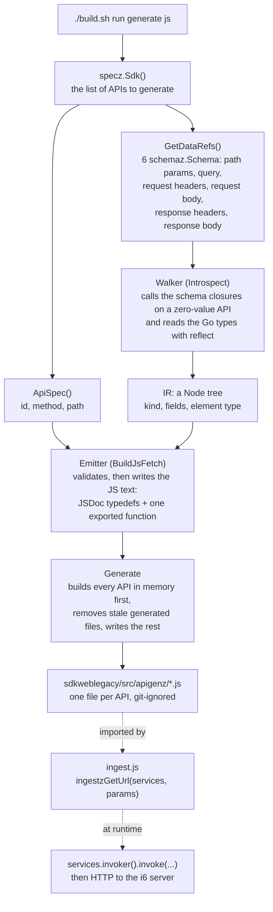

# i6sdk

The i6 SDK for the web, and the Go server that builds, serves, and tests it.

## Install

Requires Go and Node.js.

```bash
cd sdkweb
npm ci
```

## Generate

The API clients of the legacy web SDK (`sdkweblegacy/src/apigenz`, one `.js` file per API, git-ignored)
are generated from the Go API schemas in `sdkgo/apiz`:

```bash
./build.sh run generate js
```

Run it after a fresh checkout and whenever an API schema changes. `sdkweblegacy/build.sh bundle` runs
it for you. To expose a new API, add it to `specz.Sdk()` in `sdkgo/specz/specz.go`. Files are named
after the API id (`ingestz-get-url.js` exports `ingestzGetUrl(services, params)`); only files that
start with `// Code generated by generatorjsz` are ever overwritten or removed.

### How the generator works



Solid arrows run at generation time (Go); dotted arrows run in the browser (JS). Where each step lives:

| Step | Code |
|---|---|
| API list | `sdkgo/specz/specz.go` (`Sdk()`) |
| Command | `sdkgo/cmdsdkgo/cmdsdkgo_generate.go` |
| Walker and IR | `generatorjsz/generatorjsz_walk.go`, `generatorjsz_ir.go` |
| Emitter | `generatorjsz/generatorjsz_emit.go` |
| Writing and cleanup | `generatorjsz/generatorjsz_generate.go` |

## Run

```bash
cd sdkweb
./build.sh run_server
```

Starts the server at `127.0.0.1:8043` (override with the `I6_SDK_WEB_SERVER_LOCAL_ADDRESS`
env var). The SDK demo page is served at `/static/index.html`.

## Test

```bash
cd sdkweb
npm test
```

Runs the Go unit tests and the browser (QUnit) tests for the SDK.
