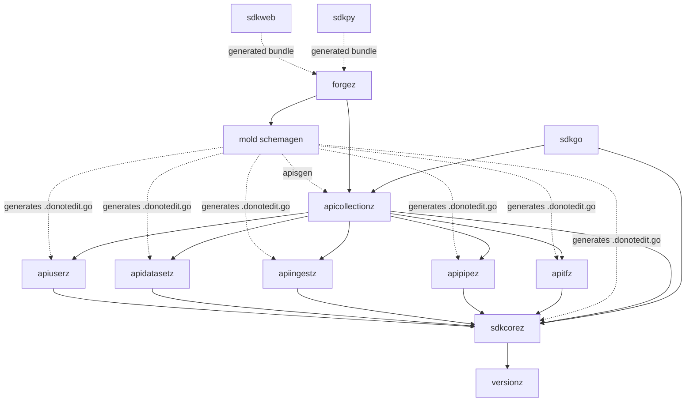

# i6sdk Mono-Repo

The unified SDK mono-repo for the Infinity6 platform, providing official language SDKs (**Go**, **Web / TypeScript**, **Python**) and automated multi-language client generators.


## Architecture

Modeled after `github.com/infinity6-ai/gox`, `i6sdk` is structured into focused, independent Go modules with strict dependency layering:

```
i6sdk/
├── build.sh                  # Workspace orchestrator (test, update, codegen, release)
├── comp.sh                   # Component runner: ./comp.sh <comp> <cmd> (test, fmt, update, clean, run)
├── go.mod                    # Root module definition
├── versionz/                 # Central version management (v0.0.1)
├── sdkcorez/                 # Foundational domain entities (dsz, grants, logzinit, productz, pipez, reqsign, resultz, sdkfuncz, speclabels, tabledataz)
├── apiuserz/                 # User, Auth, Token, Password & Settings APIs
├── apidatasetz/              # Dataset, Store, Table, Model, Payment, Plan & Stripe APIs
├── apiingestz/               # Ingestion Streaming, Events, & Batch Summary APIs
├── apipipez/                 # Pipeline execution & Scheduler APIs
├── apitfz/                   # ML Model metadata & prediction APIs
├── apicollectionz/           # Unified catalog & registry of all service APIs & SdkFuncs (SdkApis & SdkFuncs)
├── mold/                     # Schema & catalog generators (schemagen, apisgen)
├── forgez/                   # Multi-language client AST generator & bundler (forgejs, forgepy)
├── sdkgo/                    # Official Go client SDK
├── sdkweb/                   # Official Web JS/TS client SDK (ES modules & browser bundle via jsDelivr)
└── sdkpy/                    # Official Python client SDK (Python >= 3.10)
```

### Dependency Hierarchy



---

## Explicit Envelope Architecture

Every API definition across `apiuserz/`, `apidatasetz/`, `apiingestz/`, `apipipez/`, and `apitfz/` is standardized around explicit request and response envelopes:

- **Explicit HTTP Transport Slots**: Requests define explicit sub-structs for slots they consume (`Req{Params, Query, Headers, Payload}`) and responses define `Resp{Headers, Payload}`. Unused transport slots are simply omitted.
- **Go Doc Comments**: Standard doc comments (`// ...`) written above structs and fields are automatically parsed and mapped into schema summaries (`schemaz.Desc{Summary: "..."}`), eliminating documentation duplication.
- **Zero Custom Tag DSL**: Standard `json:"..."` tags handle naming and serialization natively without risk of path parameters polluting JSON request bodies.
- **Clean Checkout Compilation (`<MethodName>Id` Stubs)**: Every API package defines a compile-time stub struct `type <MethodName>Id struct{}` with an actionable panic. `SdkApis` in `apicollectionz` embeds these stubs so that fresh checkouts compile cleanly without requiring `.donotedit.go` files on disk.
- **Client Workflow Symmetry (`sdkfuncz`)**: Client workflow functions in `sdkcorez/productz/` mirror the envelope architecture with `{Input, Partitions, Output}` sub-structs and stub promotion into `apicollectionz.SdkFuncs`.

---

## Tooling Commands

### Workspace Orchestration (`build.sh`)

- **Run all tests:**
  ```bash
  ./build.sh test
  ```
- **Run unit tests only:**
  ```bash
  ./build.sh test_unit
  ```
- **Run web browser tests:**
  ```bash
  ./build.sh test_web
  ```
- **Run format across all components:**
  ```bash
  ./build.sh fmt
  ```
- **Tidy and update dependencies:**
  ```bash
  ./build.sh update
  ```
- **Enable internal module replaces across all components:**
  ```bash
  ./build.sh gomod_replace_on
  ```
- **Drop internal module replaces across all components:**
  ```bash
  ./build.sh gomod_replace_off
  ```
- **Run code generation across the mono-repo:**
  ```bash
  ./build.sh codegen
  ```
- **Check current version:**
  ```bash
  ./build.sh version
  ```
- **Increment version:**
  ```bash
  ./build.sh version-inc
  ```
- **Clean build targets:**
  ```bash
  ./build.sh clean
  ```

### Component Execution (`comp.sh`)

Run commands on specific components:

```bash
./comp.sh <component> <command>
```

Examples:
```bash
./comp.sh sdkcorez test
./comp.sh apicollectionz test
./comp.sh sdkgo test
./comp.sh sdkpy test
./comp.sh sdkweb test
```

---

## Code Generation

Running `./build.sh codegen` executes the complete generation pipeline across all tiers:

1. **Schema Generation (`mold schemagen`)**: Inspects Go AST and doc comments across all `api*z` and `sdkcorez/productz` packages to emit `<endpoint>.donotedit.go` (`ApiDataRefs()` and `SdkFuncDataRefs()`).
2. **Catalog & Stubs Generation (`mold apisgen`)**: Emits `apis.donotedit.go` and `sdkfuncs.donotedit.go` in `apicollectionz`, shadowing compile-time stubs with runtime delegating methods.
3. **Multi-Language SDK Bundles (`forgez`)**:
   - **Web JS/TS SDK**: Generates `sdkweb/src/main/sdkapis/sdkapis.js` (via `forgejs`).
   - **Python SDK**: Generates `sdkpy/src/i6sdk/sdkapis/` (via `forgepy`).
   - **Static Assets**: Generates `sdkweb/internal/stzfiles/stzfiles.blob.go`.

You can also trigger generation directly within specific components:

```bash
# Generate schemas for a single API package
cd apidatasetz/dszapidatasetlist && go generate ./...

# Re-generate apicollectionz catalog
cd apicollectionz && go generate ./...

# Re-generate Web SDK bundle
cd sdkweb && go generate ./...

# Re-generate Python SDK package
cd sdkpy && go generate ./...
```

---

## Go SDK (`sdkgo`)

High-performance, concurrency-safe Go client SDK built natively for Go applications and backend microservices:

- **Path-Based Service Routing**: Automatically routes requests across Infinity6 backend services (`decsuite`, `tfinfer`, `userz`) based on endpoint path prefixes.
- **Pluggable Token Storage**: Pure in-memory caching (`tokenstore.NewMemory()`) and persistent WAL-mode SQLite database storage (`tokenstore.NewSqlite()`).
- **Zero CGO**: Pure Go implementation with zero external C dependencies.

### Test
```bash
./comp.sh sdkgo test
```

### Quickstart
```go
package main

import (
	"context"
	"fmt"
	"log"

	"github.com/infinity6-ai/i6sdk/apidatasetz/dszapidatasetlist"
	"github.com/infinity6-ai/i6sdk/sdkgo/client"
	"github.com/infinity6-ai/i6sdk/sdkgo/config"
)

func main() {
	ctx := context.Background()

	// Initialize client with configuration
	c, err := client.New(ctx, config.Options{
		Token: "my_access_token",
		Urls:  config.SandboxUrlOptions, // Or config.DefaultUrlOptions / config.StagingUrlOptions
	})
	if err != nil {
		log.Fatalf("failed to create client: %v", err)
	}

	// Prepare typed request envelope
	api := &dszapidatasetlist.Api{
		Req: &dszapidatasetlist.Req{
			Params: &dszapidatasetlist.Params{UserId: "usr_123"},
		},
	}

	// Dispatch call via SdkApis
	status, err := c.Apis().DszListDatasets(ctx, api)
	if err != nil {
		log.Fatalf("api call failed: %v", err)
	}

	fmt.Printf("HTTP Status: %d, Datasets: %d\n", status, len(api.Resp.Payload.Datasets))
}
```

---

## Python SDK (`sdkpy`)

Lightweight, high-performance Python client SDK for Python $\ge 3.10$ with minimal runtime dependencies (`cryptography`).

### Test
```bash
./comp.sh sdkpy test
```

### Quickstart
```python
import i6sdk

client = i6sdk.create_client(
    serv_urls={"decsuite": "https://decsuite.sandbox.rs.infinity6.ai"},
)
resp = client.apis().dsz_list_datasets()
if resp.ok:
    print("Datasets:", resp.parse())
```

---

## Web SDK (`sdkweb`)

Browser-optimized JavaScript/TypeScript SDK served directly via [jsDelivr CDN](https://www.jsdelivr.com/) with zero install or build step.

### Quickstart
```html
<script src="https://cdn.jsdelivr.net/gh/infinity6-ai/i6sdk@sdkweb-dist-v0.0.8/sdkweb/dist/bundle/i6sdk-web.min.js"></script>
<script>
  const sdk = new I6Sdk();
  // sdk.apis(), sdk.funcs(), sdk.auth(), sdk.tokens(), sdk.ingest(), sdk.infer(), sdk.dash()
</script>
```

### Install & Development
```bash
cd sdkweb
npm ci
```

### Run Dev Server
```bash
cd sdkweb
./build.sh run_server
```

### Run Web Browser Tests
```bash
cd sdkweb
go test -count=1 -run '^TestWeb.*$' ./...
```
