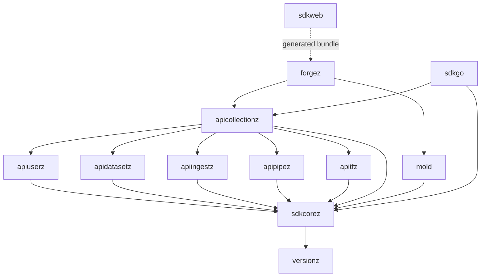

# i6sdk Mono-Repo

The unified SDK mono-repo for the Infinity6 platform, providing official language SDKs and automated multi-language client generators.

## Architecture

Modeled after `github.com/infinity6-ai/gox`, `i6sdk` is structured into focused, independent Go modules with strict dependency layering:

```
i6sdk/
├── build.sh                  # Workspace orchestrator (comps_list, test, update, codegen, release)
├── comp.sh                   # Component runner: ./comp.sh <comp> <cmd> (test, fmt, update, clean, run)
├── go.mod                    # Root module definition
├── versionz/                 # Central version management (v0.0.1)
├── sdkcorez/                 # Foundational domain entities (dsz, grants, logzinit, productz, pipez, reqsign, resultz, sdkfuncz, speclabels, tabledataz)
├── apiuserz/                 # User, Auth, Token, Password & Settings APIs
├── apidatasetz/              # Dataset, Store, Table, Model, Payment, Plan & Stripe APIs
├── apiingestz/               # Ingestion Streaming, Events, & Batch Summary APIs
├── apipipez/                 # Pipeline execution & Scheduler APIs
├── apitfz/                   # ML Model metadata & prediction APIs
├── apicollectionz/           # Unified catalog & registry of all service APIs & SdkFuncs
├── mold/                     # Multi-language code generation template engine
├── forgez/                   # AST code generator & bundler (forgejs, CLI generate)
├── sdkgo/                    # Official Go client SDK
└── sdkweb/                   # Official Web JS/TS client SDK
```

### Dependency Hierarchy



---

## Tooling Commands

### Workspace Orchestration (`build.sh`)

- **Run all tests:**
  ```bash
  ./build.sh test
  ```
- **Run format across all components:**
  ```bash
  ./build.sh fmt
  ```
- **Tidy and update dependencies:**
  ```bash
  ./build.sh update
  ```
- **Run code generation (JS SDK bundle):**
  ```bash
  ./build.sh codegen
  ```
- **Check current version:**
  ```bash
  ./build.sh version
  ```
- **Increment version:**
  ```bash
  ./build.sh version-inc
  ```
- **Clean build targets:**
  ```bash
  ./build.sh clean
  ```

### Component Execution (`comp.sh`)

Run commands on specific components:

```bash
./comp.sh <component> <command>
```

Examples:
```bash
./comp.sh sdkcorez test
./comp.sh apicollectionz test
./comp.sh forgez run generate
./comp.sh sdkweb test
```

---

## Code Generation

The JavaScript/TypeScript Web SDK client bundle (`sdkweb/src/main/sdkapis/sdkapis.js`) and embedded static files (`sdkweb/internal/stzfiles/stzfiles.blob.go`) are automatically generated:

```bash
./build.sh codegen
```

Or directly in the target language SDK:

```bash
cd sdkweb && go generate ./...
# or: cd sdkweb && go run . generate
```

---

## Web SDK (`sdkweb`)

### Install
```bash
cd sdkweb
npm ci
```

### Run Dev Server
```bash
cd sdkweb
./build.sh run_server
```

### Run Web Browser Tests
```bash
cd sdkweb
go test -count=1 -run '^TestWeb.*$' ./...
```
