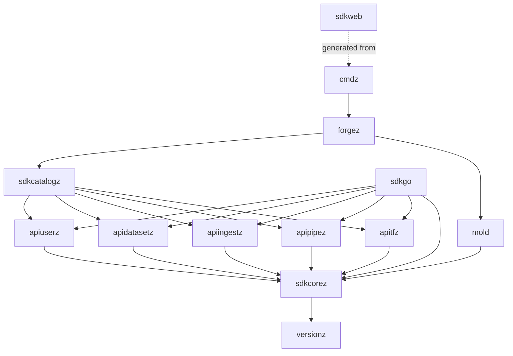

# i6sdk Mono-Repo Refactoring Plan

## 1. Overview & Vision

`i6sdk` is the unified SDK repository for the entire Infinity6 platform. It is being refactored into a structured mono-repo (modeled after `gox`) to prepare for:
1. **Multi-language support:** Core Go client (`sdkgo`), Web JavaScript/TypeScript (`sdkweb`), and future targets (Python `sdkpython`, Node `sdknode`, Java `sdkjava`).
2. **Modular service APIs:** Breaking down monolithic API definitions into independent service modules (`apiuserz`, `apidatasetz`, `apiingestz`, `apipipez`, `apitfz`).
3. **Automated Code Generation:** Using code generators (`forgez`, `mold`) to reflect on API definitions and SdkFunc specifications to generate consistent client code across all target languages.
4. **Eventual Open-Source Release:** Following clean dependency layering and open-source standards matching `github.com/infinity6-ai/gox`.

---

## 2. Current State & Architectural Bottlenecks

### Current Layout
- Root `go.mod` (`go.code.infinity6.ai/sdkgo`) mixes the Go client, domain entities, service APIs, code generators (`forgez`), template molds (`mold`), and CLI (`main.go`, `cmdsdkgo`).
- `sdkweblegacy` is a semi-detached module with legacy naming and mixed Go web-test server + JS client.

### Cyclic Dependency Issue in Tests
- `forgez/forgejs` imports `sdkgo` to read API definitions and SdkFuncs.
- `sdkgo/apiz/*_unit_test.go` files (40+ test files) import `forgez/forgejs/forgejsapi` to call `forgejsapi.NewSdk().ParseApi(ctx, api)`.
- `sdkgo/tabledataz/*_unit_test.go` and `productz/*_unit_test.go` import `forgez/forgejs/forgejsschema` to call `forgejsschema.NewSdk().ParseSchema(...)`.
- **Constraint:** In a Go workspace with separate `go.mod` files per project, module circular dependencies (even in tests) are forbidden.
- **Solution:** API structural tests must only test data validation and serialization. All AST/code-generator parsing tests belong in `forgez` (which already has `TestUnitAllApis` iterating over all registered APIs).

---

## 3. Target Architecture & Module Layout

```
i6sdk/
├── build.sh                   # Orchestrates all modules (comps_list, test, update, release, work_init)
├── comp.sh                    # Component executor: ./comp.sh <module> <cmd>
├── go.work                    # Go workspace referencing all modules
├── versionz/                  # Module: Central version management
│   └── go.mod
├── sdkcorez/                  # Module: Foundational domain types & models (Zero cross-API dependencies)
│   ├── go.mod
│   ├── dsz/                   # Lake datasets, tables, paths, domains, stores, solution IDs
│   ├── grants/                # Permissions & authorization grants
│   ├── logzinit/              # OpenTelemetry tracing & logging setup
│   ├── productz/              # Product metrics, relevance inferz, dash definitions
│   ├── reqsign/               # Request signing utilities
│   ├── resultz/               # Ingestion & catalog batch result models
│   ├── sdkfuncz/              # SdkFunc specification interfaces
│   ├── speclabels/            # Token types and spec labels
│   └── tabledataz/            # Table schemas, catalog, and feature data models
├── apiuserz/                  # Module: User, Auth, Token, Password & Settings APIs
│   └── go.mod
├── apidatasetz/               # Module: Dataset, Store, Table, Model, Payment & Plan APIs
│   └── go.mod
├── apiingestz/                # Module: Ingestion Streaming, Events, & Batch Summary APIs
│   └── go.mod
├── apipipez/                  # Module: Pipeline execution & Scheduler APIs
│   └── go.mod
├── apitfz/                    # Module: ML Model metadata & prediction APIs
│   └── go.mod
├── sdkcatalogz/               # Module: Catalog/Registry aggregating all APIs and SdkFuncs
│   └── go.mod                 # (Provides SdkApis() and SdkFuncs() for forgez/generators)
├── mold/                      # Module: Template engine & molds for language code generators
│   └── go.mod
├── forgez/                    # Module: Multi-language Code Generation Engine
│   ├── go.mod
│   └── forgejs/               # JavaScript/TypeScript AST generation & bundling
├── cmdz/                      # Module: i6sdk CLI (Code Generator & Dev Tooling)
│   ├── go.mod
│   ├── main.go
│   └── cmdsdk/
├── sdkgo/                     # Module: Official Golang Client SDK
│   └── go.mod
└── sdkweb/                    # Module: Official Web JS/TS Client SDK (migrated from sdkweblegacy)
    ├── go.mod
    └── package.json
```

---

## 4. Strict Dependency Hierarchy



---

## 5. Execution Phases

### Phase 0: Decouple Tests & Eliminate Circular Dependencies
- [ ] Remove `forgejsapi` calls from unit tests in `sdkgo/apiz/...`.
- [ ] Remove `forgejsschema` calls from unit tests in `sdkgo/tabledataz/...`, `productz/...`, `dsz/...`.
- [ ] Enhance `forgez/forgejs/forgejsapi` and `forgez/forgejs/forgejsschema` unit tests to ensure 100% schema and API parsing coverage across all APIs via `sdkz.Apis()` / `sdkz.SdkFuncs()`.
- [ ] Run full test suite to verify all unit tests pass without relying on cross-module test imports.

### Phase 1: Core Domain Extraction (`versionz` & `sdkcorez`)
- [ ] Create `versionz/` with `go.mod`.
- [ ] Create `sdkcorez/` with `go.mod`.
- [ ] Move base packages into `sdkcorez/`:
  - `dsz/`
  - `grants/`
  - `logzinit/`
  - `productz/`
  - `reqsign/`
  - `resultz/`
  - `sdkfuncz/`
  - `speclabels/`
  - `tabledataz/`
- [ ] Update internal import paths within `sdkcorez/`.
- [ ] Verify `sdkcorez` unit tests pass independently.

### Phase 2: Service API Extraction (`api*z`)
- [ ] Create `apiuserz/` (`go.mod`):
  - Move `sdkgo/apiz/userapi/*`
- [ ] Create `apidatasetz/` (`go.mod`):
  - Move `sdkgo/apiz/dszapi/*`
- [ ] Create `apiingestz/` (`go.mod`):
  - Move `sdkgo/apiz/ingestzapi/*`
- [ ] Create `apipipez/` (`go.mod`):
  - Move `sdkgo/apiz/pipezapi/*`
- [ ] Create `apitfz/` (`go.mod`):
  - Move `sdkgo/apiz/tfzapi/*`
- [ ] Verify each API module compiles and unit tests pass with dependencies only on `sdkcorez`.

### Phase 3: Registry, Molds & Generators (`sdkcatalogz`, `mold`, `forgez`, `cmdz`)
- [ ] Create `sdkcatalogz/` (`go.mod`):
  - Move `sdkgo/sdkz/sdkz_apis.go` and `sdkz_sdkfuncz.go`.
  - Expose API and SdkFunc registries.
- [ ] Setup `mold/` as an independent module with its own `go.mod`.
- [ ] Setup `forgez/` as an independent module with its own `go.mod`:
  - Update imports to use `sdkcatalogz`, `mold`, `sdkcorez`.
- [ ] Create `cmdz/` (`go.mod`):
  - Move `main.go`, `cmdsdkgo`, and `sdkgo/internal/cmd` into `cmdz`.
  - Provide CLI entry points (e.g. `cmdz js generate`).

### Phase 4: Go Client SDK (`sdkgo`)
- [ ] Transform `sdkgo/` into a dedicated Go client library.
- [ ] Reorganize client configuration, auth helpers, middleware, and high-level client interfaces.
- [ ] Create dedicated `sdkgo/go.mod` depending on `sdkcorez` and `api*z`.
- [ ] Verify Go SDK tests.

### Phase 5: Web SDK Migration (`sdkweb`)
- [ ] Rename / migrate `sdkweblegacy` to `sdkweb`.
- [ ] Clean up legacy dependencies and align `build.sh` / `package.json`.
- [ ] Update `cmdz` generator output to write to `sdkweb/src/sdkapis/sdkapis.js`.
- [ ] Verify code generation produces valid JavaScript/TypeScript bundles.
- [ ] Verify `sdkweb` test suite.

### Phase 6: Mono-Repo Tooling (`build.sh`, `comp.sh`, `go.work`)
- [ ] Implement `comp.sh` component runner:
  - `./comp.sh <comp> test`
  - `./comp.sh <comp> update`
  - `./comp.sh <comp> fmt`
  - `./comp.sh <comp> clean`
- [ ] Implement root `build.sh` matching `gox/build.sh`:
  - `cmd_comps_list`: Ordered list of components (`versionz`, `sdkcorez`, `api*z`, `sdkcatalogz`, `mold`, `forgez`, `cmdz`, `sdkgo`, `sdkweb`).
  - `cmd_work_init`: Generates `go.work`.
  - `cmd_test`: Executes tests across all components.
  - `cmd_update`: Tidies all modules.
  - `cmd_codegen`: Runs code generation.
  - `cmd_release`: Prepares versioned tags per component.
- [ ] Remove root `go.mod` and legacy artifacts.

### Phase 7: Validation & Verification
- [ ] Run `./build.sh test` to execute all unit tests.
- [ ] Run `./build.sh codegen` and check for git diff cleanliness.
- [ ] Verify CI scripts (`meta/ci/ci.sh`) are updated and passing.
